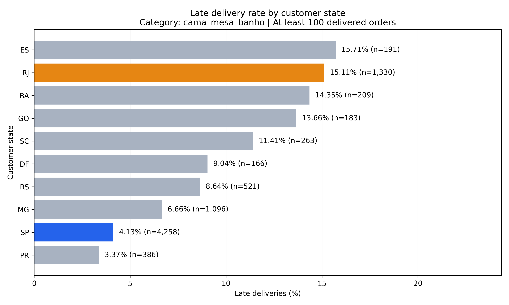
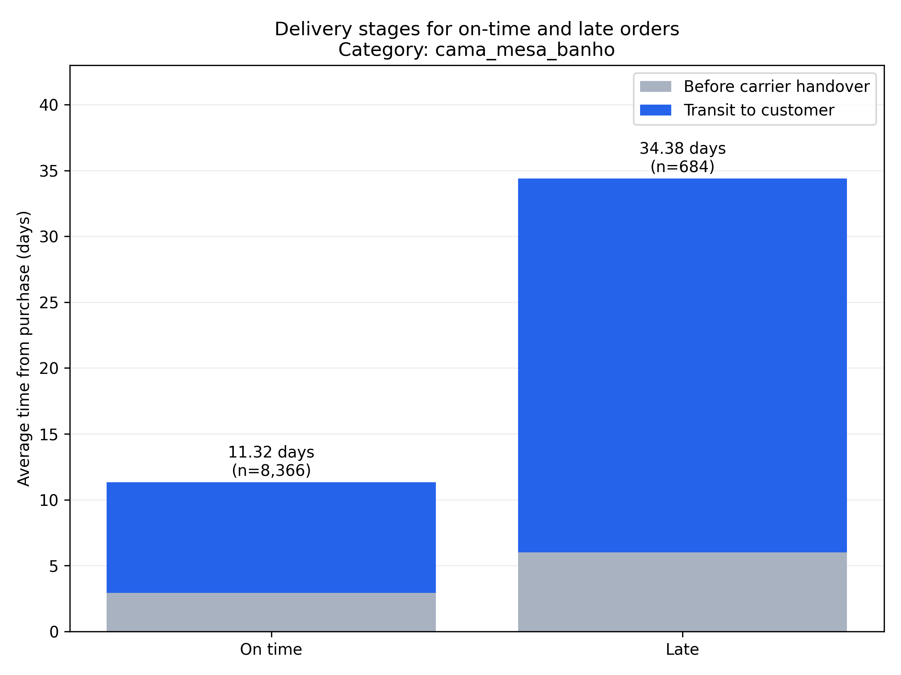

# Olist delivery delay analysis

Independent portfolio project by Azra Ar using SQL, SQLite, Python and Google Colab to examine delivery delays in published Brazilian e-commerce order data.

The analysis identifies categories and destination states that merit closer operational investigation. It combines late-delivery rates with affected order counts and elapsed delivery-stage times.

## Main findings

| Measure | Result |
| --- | --- |
| Delivered orders with actual and estimated delivery dates | 96,470 |
| Orders delivered after the estimated calendar day | 6,534 |
| Late delivery rate | 6.77% |
| Mean delay among late orders | 10.62 calendar days |
| Maximum observed delay | 188 calendar days |

In the single-category cohort, `cama_mesa_banho` has 684 late orders out of 9,069 deliveries, a 7.54% rate. It has the largest late-order count among categories with at least 100 eligible deliveries. `audio` has the highest rate in that ranking at 11.99%, based on 41 late orders out of 342 deliveries.

For `cama_mesa_banho`, late orders spend an average of 6.01 days before carrier handover and 28.37 days in transit. On-time orders spend 2.94 and 8.38 days in those stages. The larger observed difference occurs in transit.

### Destination states in the selected category

| Destination | Eligible deliveries | Late deliveries | Late rate | Mean actual window | Mean estimated window |
| --- | ---: | ---: | ---: | ---: | ---: |
| RJ | 1,330 | 201 | 15.11% | 16.84 days | 27.02 days |
| SP | 4,258 | 176 | 4.13% | 9.33 days | 20.47 days |

Actual and estimated windows are measured from purchase calendar date. These means cover both on-time and late orders. Early deliveries can lower a mean while a subset still arrives late.

RJ is a priority for follow-up based on its late-order count and rate in this category. Investigation could compare seller origins, order periods, transit distributions and estimated delivery windows.

## Visual results

## Scope and definitions

- An order is late when its actual delivery calendar date is later than its estimated delivery calendar date. Delivery on the estimated date counts as on time.
- Overall delivery performance includes delivered orders with both delivery dates available and parseable by SQLite.
- Category and regional analyses count each order once. Every item must have a known category and all items must share that category. Mixed-category orders and incomplete category assignments are excluded from these comparisons.
- Category rankings require at least 100 eligible delivered orders per category. State rankings apply the same threshold within `cama_mesa_banho`. This is a descriptive reporting threshold.
- Stage comparisons use full timestamps and nonnegative elapsed durations. Of the 96,470 delivery-date eligible orders, one has missing or unreadable stage timestamps and 188 have inconsistent stage ordering. The overall stage comparison includes 96,281 orders.
- The selected category contains 9,050 orders with eligible stage durations, compared with 9,069 in the delivery-date analysis. Stage and window cohorts are documented separately.
- State refers to customer destination. The elapsed times include weekends.

The results are descriptive associations. Seller location, distance, time period, product characteristics and delivery estimates can affect comparisons. The notebook supports prioritisation for investigation. Causal attribution and the effect of a proposed intervention require further analysis. The extreme delay is retained as an observed value and has not been independently investigated.

## Files

| Path | Contents |
| --- | --- |
| `notebooks/01_olist_delivery_analysis.ipynb` | Guided Colab notebook with saved results and explanatory text |
| `sql/` | Eleven standalone SQLite queries extracted from the notebook |
| `results/` | Ten CSV summaries, including date-quality and key checks |
| `results/figures/` | Two exported PNG figures |
| `data/README.md` | Required source files and table mapping |

## Reproduce in Google Colab

1. Download the source dataset from the link below and unzip it.
2. Upload `notebooks/01_olist_delivery_analysis.ipynb` to Google Colab.
3. Run the notebook from top to bottom. Upload orders at the first prompt, order items and products together at the second prompt, and customers at the third prompt. Preserve the original CSV filenames.
4. The final export cell downloads five category and regional CSV summaries and two figures. The other saved CSV summaries in this repository were extracted from the corresponding notebook outputs.

The Python dependencies are listed in `requirements.txt`. SQLite is included with Python. SQL files target the four tables created by the notebook. They can also run against a SQLite database containing the same source tables. Every SQL file is self-contained and uses named output columns. The preview query has no explicit ordering and is intended for inspection.

## Verification

All five supplied result CSVs were checked against the uploaded notebook tables, and both supplied figures were visually reviewed. The saved key checks show unique order IDs, product IDs and customer IDs in their respective tables. Extracted SQL queries were executed on a small constructed dataset to check date handling, category grouping and missing-value exclusions.

Verification during packaging used the supplied notebook and aggregated results. The four raw CSVs were not supplied with that packaging request, so a fresh full-source run was not performed during packaging. The notebook retains the user's recorded full-data results.

## Data source

Olist, *Brazilian E-Commerce Public Dataset by Olist*.

https://www.kaggle.com/datasets/olistbr/brazilian-ecommerce

Download the source CSVs from the dataset page and consult its current attribution and licence terms. The project package contains aggregated results and source-file instructions. This is an independent student analysis.
